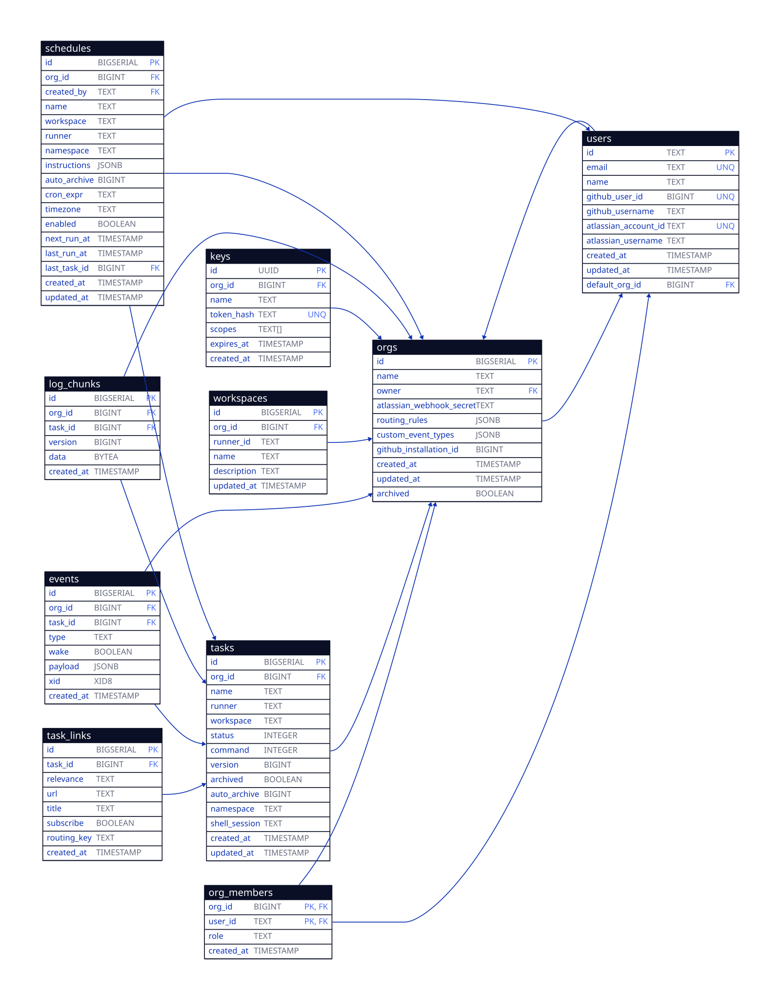

# GRITZ

Runs coding agents (Claude Code, Codex, Cursor, GitHub Copilot) inside remote sandboxes.

Documentation: https://docs.gritz.dev

## Features

- **Self-hosted runners** - Run agents on your own infrastructure inside Docker containers
- **Third-party integrations** - Interact with agents via GitHub and Jira events
- **MCP server** - Create and manage tasks from Claude Code, Cursor, or any MCP client

## Web UI


## Running a runner

Runners run tasks on your own infrastructure. To set one up, follow
[Runner](https://docs.gritz.dev/operators/runner/) in the operator docs, which
also cover [`workspaces.yaml`](https://docs.gritz.dev/operators/workspaces-yaml/),
[secrets](https://docs.gritz.dev/operators/secrets/),
[deployment](https://docs.gritz.dev/operators/deployment/) and
[debugging](https://docs.gritz.dev/operators/debugging/).

## Local Development

```bash
# Start server and postgres locally
docker compose up -d

# Run the FE
cd webui
pnpm install
pnpm run dev
```

The local server runs with `--no-auth`, but the runner still requires an API key.
Create one in the local Web UI at http://localhost:5173/ui/keys/new, then start the runner:

```bash
gritz runner --server http://localhost:6464 -key <api-key>
```


### Build

```bash
mise run build      # Build main + prebuilt binaries (linux amd64/arm64)
mise run generate   # Generate protobuf code
go build            # Build main binary only
```

## Events

Links, subscriptions and how events wake tasks are covered in
[Events and links](https://docs.gritz.dev/concepts/events-and-links/).

## Architecture


## Schema


