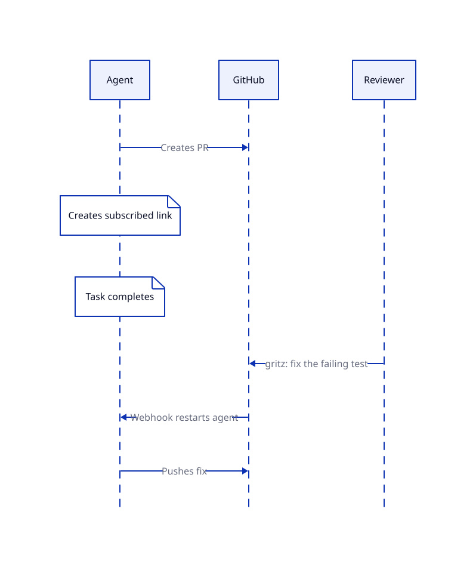

Tasks don't end when their agent stops. An agent that opens a pull request links
it to its task, and a review comment on that pull request later wakes the task up
to address it.

## Links

A link connects a task to an external resource: a pull request, an issue, a Jira
ticket, a dashboard. It has:

- a **URL**, ideally one a person can open;
- a **relevance**, saying how the resource relates to the task, such as "PR
  implementing the fix";
- an optional **title** to display;
- an optional **kind**, one of the [link kinds](/concepts/agents/#link-kinds) of
  the task's agent. A link with a kind is subscribed: events about the resource
  reach the task. A link without one is a plain reference.

Agents create links with the [`create_link`](/using/agent-tools/#create_link)
tool, and gritz tells every agent to create a subscribed link for each resource
it creates, such as a pull request, an issue or a comment, with one of its
agent's link kinds. A task created by an agent's
[trigger](/concepts/agents/#the-triggers-link) can also get a subscribed link
to the resource of the event that created it.

Links are listed in the task page's sidebar, with their kind and
[claim](/concepts/agents/#claims), and appear on its timeline. They can't be
removed: a task stays subscribed until it is archived.

## Subscriptions

A subscribed link names a resource of its kind's link type: a GitHub pull
request or issue, a GitHub Actions workflow run, a Jira issue, or a custom
event's URL. When an event arrives about the same resource, gritz delivers it to
every task with a subscribed link to it whose kind lists the event's type,
rather than starting a new task.

The resource has to match:

- **GitHub and Jira URLs** are matched by the issue, pull request, workflow run
  or Jira issue they point at. A comment's URL, a pull request's `/files` page
  and the API URL of the same pull request all match a link to the pull request,
  and every job of a workflow run matches the run. A subscribed link is stored
  with the resource's own URL, and creating one with a URL that isn't a resource
  of its kind's type fails.
- **Custom events' URLs** must match exactly, character for character. A
  different query string or a trailing slash is a different resource. See
  [The URL is the subscription key](/integrations/custom-events/#the-url-is-the-subscription-key).

Archived tasks aren't subscribed to anything. An event about a resource whose
only subscriber is archived is treated as if nobody were subscribed.

## How an event reaches a task

Events come from the [GitHub](/integrations/github/) and
[Jira](/integrations/jira/) integrations and from your own systems
through [custom events](/integrations/custom-events/). For each event, in each
organisation it belongs to, gritz:

1. **Delivers it to subscribed tasks.** Every task with a subscribed link to the
   event's resource gets the event, if the link's kind lists the event's type,
   the event meets that type's conditions, and the event's author is a member or the kind is
   [public](/concepts/agents/#members-and-public). Delivery wakes the task.
2. **Runs every agent's triggers.** Each [agent](/concepts/agents/) whose
   trigger matches the event creates a task of its own, with the event as its
   first event, unless the trigger
   [yields](/concepts/agents/#claims) to a task that holds a claim on the
   resource.

The two steps are independent: an event can wake one task and create another.
An event that no link kind delivers and no trigger matches does nothing.

A woken task that has finished starts a new run. A running task isn't
interrupted: it runs again as soon as its current run ends. Either way the agent
gets the event at the start of its next run.

## Where events show up

- **The task's timeline** shows each event delivered to the task, with its
  source, description, URL and text, next to the instructions and the agent's
  reports.
- **Events → Recent Events** in the [Web UI](/using/web-ui/#events) lists the
  organisation's latest delivered events, each linked to its task. Events that
  reached no task aren't stored, so they don't appear.
- **The test event form** on the **Agents** page shows what an event would do
  before you rely on it. See
  [Testing with a test event](/concepts/agents/#testing-with-a-test-event).
