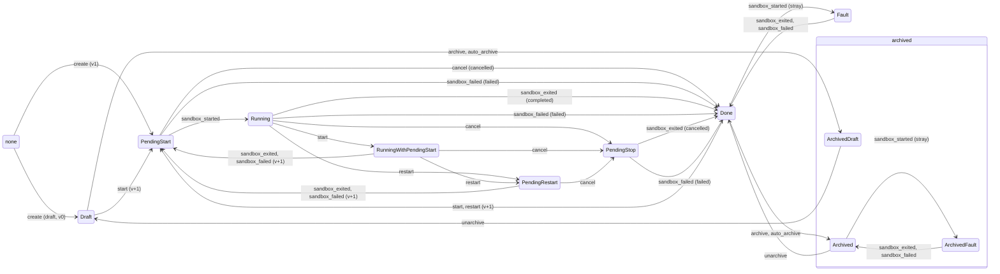

Issue: https://github.com/gritzapp/gritz/issues/2264

## Problem

A task's event stream has two kinds of event that describe its state changes:

- **Lifecycle** events (`LifecyclePayload`): `created`, `updated`, `cancelled`, `restarted`, `archived`, `unarchived`, `auto_archived`, `sandbox_started`, `sandbox_exited`, `sandbox_failed`. They are history: an actor, a from and a to status, rendered in the timeline.
- **Command** events (`CommandPayload`: command, version, runner, workspace). One is written whenever `Task.Command` or `Task.Version` changes. They are hidden from history views; the runner and the driver act on the latest one. The runner also reads archive state, which it takes from lifecycle kinds.

Each site that changes a task writes both in one transaction, but they don't line up one-to-one:

- The event router's wake writes a command event and no lifecycle event.
- A runner event that clears the command, or moves a start queued on a running task to the next run's version, writes a command event beside its sandbox lifecycle event.
- A name update, archive and unarchive write a lifecycle event and no command event.
- Starting a draft is recorded as `updated`, and `UpdateTask` with `start` writes an `updated` event that says the status changed even when the start gate rejected the start.
- Opening a debug shell is a start, recorded as `restarted`.

Neither kind is a complete record. The state machine itself exists only as the methods on `model.Task`, and `Task.Status` and `Task.Command` are the only place its state is written down in full. Its states are status/command pairs, which hide what is actually going on: whether a run is live, and what has been asked of it.

## Design

### The model

A task is a state machine. Its event stream is the source of truth, and each event that changes the task's state is a **transition**.

- **One event type.** Lifecycle and command events collapse into a single event type, `transition`. Command events go away.
- **Transitions carry inputs, not outcomes.** A transition carries its kind and its inputs: the actor, the run version a sandbox report is scoped to, a failure reason. It does not carry the resulting state, because the outcome depends on the state it applies to. `sandbox_exited` from Running goes to Done; from RunningWithPendingStart, to PendingStart at the next version.
- **State is a projection.** The state, the version and the outcome are a fold over the task's transitions. They exist to gate which transitions are possible next: a transition is accepted if the state has an edge for it, and nothing else is consulted.
- **Rejected inputs leave no trace.** An input with no edge from the current state (a start on a pending task, a sandbox report for a stale version, a duplicate report) produces no transition. The stream only holds transitions that changed the projection.
- **Everyone folds the same transitions.** The server, the runner and the driver fold the same stream with the same function, and each acts on the states it cares about.

What were command-event semantics become things a transition does to the projection. "Command cleared" is what `sandbox_started` does to PendingStart. The run boundary is what `sandbox_exited` does to a state with a start pending. The router's wake on a running task is an ordinary `start` transition.

Events that aren't transitions (instructions, external events, links, reports) stay as they are; the fold skips them.

### States

A state names what is happening to the live run and what is pending. "Pending" means requested but not yet done: the server records it before the runner acts on it.

| State | Live run | Pending | Runner action |
| --- | --- | --- | --- |
| `none` | no | — (task not created yet; the zero value) | none |
| `Draft` | no | nothing until started | none |
| `PendingStart` | no | start run `v` | start run `v` |
| `Running` | yes, run `v` | nothing | none |
| `RunningWithPendingStart` | yes, run `v` | start `v+1` once run `v` exits | none |
| `PendingStop` | yes, run `v` | stop | stop |
| `PendingRestart` | yes, run `v` | stop, then start | stop |
| `Done` | no | nothing | none |
| `Fault` | stray sandbox | stop | stop |
| `Archived` | no | — | destroy the sandbox |
| `ArchivedDraft` | no | — | destroy the sandbox |
| `ArchivedFault` | stray sandbox | stop | stop |

Beside the state, the projection holds the version `v` (the run counter) and, in `Done` and the states reached from it, the **outcome**: completed, failed or cancelled.

- **Done and its outcome.** Completed, Failed and Cancelled have the same outgoing edges, so they are one state. The outcome is set by the transition that enters `Done`: `sandbox_exited` from Running is completed, `sandbox_failed` is failed, `cancel` from PendingStart and `sandbox_exited` from PendingStop are cancelled. Leaving `Fault` keeps the outcome it had.
- **A start waits in two places.** PendingStart has no live run; RunningWithPendingStart has one left to finish. Both end up starting run `v+1`, through the same PendingStart.
- **A stop waits in two places.** PendingStop and PendingRestart both have a live run being stopped. They differ only in whether a start follows.
- **Archived is part of the state.** "Archived blocks start, restart and cancel" falls out of the table: the archived states have no such edges. There are only three, because only resting states can be archived. Archiving destroys the task's sandbox, which the runner does on entering `Archived` or `ArchivedDraft`.

The user-facing status is projected from the state and the outcome:

| State | Status |
| --- | --- |
| `Draft`, `ArchivedDraft` | draft |
| `PendingStart` | pending |
| `Running`, `RunningWithPendingStart` | running |
| `PendingRestart` | restarting |
| `PendingStop` | cancelling |
| `Done`, `Fault`, `Archived`, `ArchivedFault` | the outcome |

`Fault` shows the outcome rather than cancelling: stopping a stray sandbox is the runner cleaning up, not something a user asked for. The archived flag shown in the UI is whether the state is one of the three archived ones.

### Transitions

The transition kinds are `create`, `start`, `restart`, `cancel`, `archive`, `auto_archive`, `unarchive`, `sandbox_started`, `sandbox_exited` and `sandbox_failed`. Each `sandbox_*` transition carries the run version it reports on and is accepted only if that is the task's current version (0 stays the unscoped bypass).

The same edges as a table. Every state/transition pair not listed is rejected.

| From | Transition | To |
| --- | --- | --- |
| `none` | `create` (draft) | `Draft`, v0 |
| `none` | `create` | `PendingStart`, v1 |
| `Draft` | `start` | `PendingStart`, v+1 |
| `Draft` | `archive`, `auto_archive` | `ArchivedDraft` |
| `PendingStart` | `sandbox_started` | `Running` |
| `PendingStart` | `cancel` | `Done` (cancelled) |
| `PendingStart` | `sandbox_failed` | `Done` (failed) |
| `Running` | `start` | `RunningWithPendingStart` |
| `Running` | `restart` | `PendingRestart` |
| `Running` | `cancel` | `PendingStop` |
| `Running` | `sandbox_exited` | `Done` (completed) |
| `Running` | `sandbox_failed` | `Done` (failed) |
| `RunningWithPendingStart` | `restart` | `PendingRestart` |
| `RunningWithPendingStart` | `cancel` | `PendingStop` |
| `RunningWithPendingStart` | `sandbox_exited`, `sandbox_failed` | `PendingStart`, v+1 |
| `PendingStop` | `sandbox_exited` | `Done` (cancelled) |
| `PendingStop` | `sandbox_failed` | `Done` (failed) |
| `PendingRestart` | `cancel` | `PendingStop` |
| `PendingRestart` | `sandbox_exited`, `sandbox_failed` | `PendingStart`, v+1 |
| `Done` | `start`, `restart` | `PendingStart`, v+1 |
| `Done` | `archive`, `auto_archive` | `Archived` |
| `Done` | `sandbox_started` | `Fault` |
| `Fault` | `sandbox_exited`, `sandbox_failed` | `Done`, outcome unchanged |
| `ArchivedDraft` | `unarchive` | `Draft` |
| `Archived` | `unarchive` | `Done` |
| `Archived` | `sandbox_started` | `ArchivedFault` |
| `ArchivedFault` | `sandbox_exited`, `sandbox_failed` | `Archived` |

`unarchive` also clears the auto-archive delay, as it does today, so the archiver doesn't archive the task again on its next tick.

### What the states change

- **Restart from Done is a start.** Restarting a finished task and starting it do the same thing: there is no run to stop, so both go to PendingStart at `v+1`. The transition keeps its kind, so the timeline still says "restarted", but there is no separate pending-restart state.
- **Restart in place goes through PendingStart.** Restart on a live run (Running or RunningWithPendingStart) goes to PendingRestart. This is a path users take: it is what the UI's Restart button does on a running task. The runner stops the run; its exit moves the task to PendingStart at `v+1`; the runner starts it.
- **The version stays with the live run.** Neither `start` on a running task nor `restart` bumps the version when it is recorded. The bump happens when the live run ends, on the edge both "start follows" states share: `sandbox_exited` → PendingStart at `v+1` → `sandbox_started` → Running. Today a restart bumps the version up front, so a cancel during a restart leaves the task in Cancelling at `v+1` while the run being stopped reports its exit at `v`. That report is stale and rejected, and the task stays in Cancelling. Here, `cancel` from PendingRestart goes to PendingStop at `v`, the live run's exit carries `v`, and it lands in Done.
- **A stray start is a Fault, not a cancel.** A sandbox that starts after its task left the run (a container coming up after a pending task was cancelled) goes to `Fault`, and the runner stops it. Today it goes to Cancelling, so the timeline shows a cancel nobody asked for. Since Completed, Failed and Cancelled are one state, this covers all three. Today only Cancelled accepts a stray start. On an archived task the stray start goes to `ArchivedFault`, which returns to `Archived` when the sandbox is gone. A draft has never had a run, so a start report on `Draft` or `ArchivedDraft` is rejected.
- **The ending of a live run decides the pending start, not the way it ended.** A `sandbox_failed` on RunningWithPendingStart or PendingRestart goes to PendingStart at `v+1`, like `sandbox_exited`. Today it goes to Failed and drops the start. The start was asked for explicitly (a restart, or a wake for a new event), and the run it was waiting on is over either way. If the sandbox itself is broken, run `v+1` fails too and the task lands in Done (failed), so this cannot loop.
- **A duplicate start report is rejected.** Today a repeated `sandbox_started` on Running with a queued start clears the queued start. Here RunningWithPendingStart has no `sandbox_started` edge: the run it reports on already started. "Reject" and "stay in RunningWithPendingStart" are the same thing in this model, since an input that changes nothing writes no transition.
- **`start` on RunningWithPendingStart is rejected.** A start is already pending; today it passes `CanStart` and changes nothing.
- **Every transition is a state change.** The exceptions today, where the command changed without the status, are now distinct states.

### Projections and who acts on them

The **server** stores the projection in the `tasks` row. It is a cache of the fold, updated in the same transaction as the transition is appended, so the gates and task listings never refold history.

The **runner** and the **driver** fold the same transitions into their own projection and act on the state, not on a command:

| State | Action |
| --- | --- |
| `PendingStart`, at `v` | Start run `v` |
| `PendingStop`, `PendingRestart`, `Fault`, `ArchivedFault` | Stop the live run |
| `Archived`, `ArchivedDraft` (runner only) | Destroy the sandbox |
| Anything else | Nothing |

RunningWithPendingStart needs no runner action: the pending start is server-side until the run exits. PendingRestart needs only a stop: the start that follows arrives as an ordinary PendingStart.

The runner and driver already see the whole stream: the runner keeps its projection in its local replica and folds each page of events onto it; the driver folds its event file. Today they each pick out "the latest command event", and the runner also picks "the latest archive lifecycle event". Both become one fold.

### Mapping from today

Transitions:

- `created` → `create`. The runner and workspace move from the command event to `create`; they never change afterwards.
- `updated` with a start (including starting a draft), the router's wake, and the debug shell → `start`.
- `restarted` → `restart`, except when it records a debug shell, which becomes `start`.
- `cancelled` → `cancel`.
- `archived` → `archive`, `auto_archived` → `auto_archive`, `unarchived` → `unarchive`.
- `sandbox_started`, `sandbox_exited`, `sandbox_failed` keep their names.
- Command events have no replacement.

States, for the backfill:

| Status / command today | State |
| --- | --- |
| Draft | `Draft` |
| Pending / start, Pending / restart, at `v` | `PendingStart`, at `v` |
| Running | `Running` |
| Running / start | `RunningWithPendingStart` |
| Restarting / restart, at `v` | `PendingRestart`, at `v-1` |
| Cancelling / stop, last lifecycle event `cancelled` | `PendingStop` |
| Cancelling / stop, last lifecycle event `sandbox_started` | `Fault` |
| Completed, Failed, Cancelled | `Done`, with that outcome |
| any of the above, archived | the archived state for it |

The timeline shows transitions. Its from and to statuses are no longer stored: the server folds the stream when it returns history and attaches the state before and after each transition.

## Implementation Plan

1. **Shared fold** — Delivers: the states, the transition kinds and a fold that applies one transition to a projection (state, version, outcome) and reports whether it was accepted. `Start`, `Restart`, `Cancel`, `Archive`, `Unarchive` and `ApplyRunnerEvent` become calls into it, and `Task.Status` is projected from it. Depends on: nothing. Verifiable by: unit tests covering every row of the transition table and every rejected state/transition pair.
2. **Server writes transitions** — Delivers: the `transition` payload in the proto, appended at every site that changes a task (task API, shell, runner events, event router, archiver, schedules), beside today's events and hidden from the timeline. A migration backfills transitions into existing streams and states into the `tasks` rows (see Trade-offs). Depends on: (1). Verifiable by: store tests asserting that folding a task's transitions reproduces its `tasks` row after each RPC, and the migration checking the same for every existing task.
3. **Runner folds transitions** — Delivers: the runner acts on folded states, replacing its reads of command events and archive lifecycle kinds. Depends on: (2). Verifiable by: the runner and e2e suites.
4. **Driver folds transitions** — Delivers: the driver loop acts on its folded state instead of the latest command event; restart in place becomes a stop followed by an ordinary start. Depends on: (2). Verifiable by: the driverserver and e2e suites.
5. **Drop lifecycle and command events** — Delivers: the timeline renders transitions, with from/to states computed by the server; the server stops writing lifecycle and command events; a migration deletes both from existing streams; `LifecyclePayload`, `CommandPayload` and `TaskCommand` are deleted. Depends on: (3), (4). Verifiable by: the timeline against a task that went through each edge, and the e2e suite.

## Trade-offs

**Restart in place costs a round trip.** Today the driver stops the old run and starts the new one itself, in about 350ms. Here the old run's exit goes to the server, which records PendingStart at `v+1`, and only then does the driver start the new run. In exchange, a restart has no state of its own that can strand the task, the version always belongs to the live run, and the runner and driver only ever start from PendingStart.

**Carry the resulting state on each transition.** Stamping each transition with its resulting state and version would let a consumer read the latest event instead of folding, which is what command events do today. It is rejected because it records the same thing twice, the input and the outcome, and lets them disagree: an event's stored outcome is only right if the writer applied the same rules the reader would. Folding costs little: per-task streams are short, and both the runner and the driver already process the whole stream.

**Keep command events as a derived, internal stream.** Command events could stay as the runner's and driver's view, written from the fold. That keeps today's mismatch in a new form: two event types to keep in step, one of which is a lossy summary of the other.

**Keep Completed, Failed and Cancelled as states.** They have identical outgoing edges, so splitting them triples the edges into and out of them (and into the archived states) without gating anything differently. The outcome is still projected, so the UI loses nothing.

**Make archived a flag.** Archived could stay a flag beside the state, as today. Making it part of the state turns "archived blocks start, restart and cancel" from a check in every gate into missing edges, and makes the stray start on an archived task its own state rather than a special case of `sandbox_started`.

**Backfill old streams rather than start fresh.** The runner and driver fold from the start of a stream, so a task created before (2) needs transitions for its whole history. Neither old event type is enough alone: router wakes left no lifecycle event, and a gated-out `updated` records a start that never happened. Together they are: every command change wrote a command event, and every other transition wrote a lifecycle event, in the same transaction. The backfill pairs the events each transaction wrote, maps each pair to one transition (or none, for an `updated` that changed nothing), and checks that the fold reproduces the state mapped from the `tasks` row. The alternative, archiving every live task at deploy and starting only new tasks on transitions, is simpler but interrupts running work.

## Open Questions

- **`none`.** Keep it as the zero-value initial state, so `create` is an ordinary transition from it? Or treat `create` as a constructor and have every stream start in `Draft`? In the second form, a task created started writes `create` and `start` in the same transaction, there is no separate draft create, and the version only ever moves on `start` and on a run's exit. Either way, the name is open too: `none`, `Initial` or `New`.
- **`Fault` and `ArchivedFault`.** Keep them as states, or fold them into PendingStop, with the stray start recorded as its own transition kind so the timeline still doesn't show a cancel? The states keep the outcome and the archived state intact without special cases; folding them leaves fewer states, but PendingStop then has to remember where to return to.
- **Name updates.** `updated` changes the name or the auto-archive delay and leaves the state alone. Is it a transition that every state loops on, or a separate event type? A transition keeps "every change to the task is one event type". A separate event type keeps `transition` to the state machine, so the runner and driver fold nothing they don't act on.

## Affected areas

- `internal/model/task.go`, `internal/model/event.go`
- `proto/gritz/v1/gritz.proto` (`LifecyclePayload`, `CommandPayload`, `TaskCommand`)
- `internal/server/apiserver` (task, shell and runner handlers), `internal/server/eventrouter`, `internal/server/archiver`
- `internal/runner/runnerstore`, `internal/runner/taskmanager.go`, `internal/runner/taskrunner.go`
- `internal/runner/driverserver`
- `webui/` timeline
