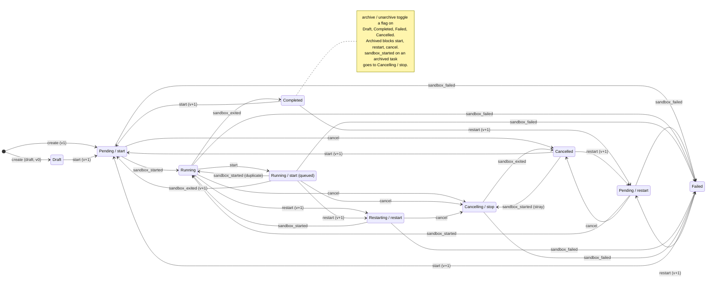

Issue: https://github.com/gritzapp/gritz/issues/2264

## Problem

A task's event stream has two kinds of event that describe its state changes:

- **Lifecycle** events (`LifecyclePayload`): `created`, `updated`, `cancelled`, `restarted`, `archived`, `unarchived`, `auto_archived`, `sandbox_started`, `sandbox_exited`, `sandbox_failed`. They are history: an actor, a from and a to status, rendered in the timeline.
- **Command** events (`CommandPayload`: command, version, runner, workspace). One is written whenever `Task.Command` or `Task.Version` changes. They are hidden from history views; the runner and the driver act on the latest one. The runner also reads archive state, which it takes from lifecycle kinds.

Each site that changes a task writes both in one transaction, but they don't line up one-to-one:

- The event router's wake writes a command event and no lifecycle event.
- A runner event that clears the command, or moves a start queued on a running task to the next run's version, writes a command event beside its sandbox lifecycle event.
- A name update, archive and unarchive write a lifecycle event and no command event.
- `UpdateTask` with `start` writes an `updated` event that says the status changed even when the start gate rejected the start.
- Opening a debug shell is a start, recorded as `restarted`.

Neither kind is a complete record. The state machine itself exists only as the methods on `model.Task`, and `Task.Status` and `Task.Command` are the only place its state is written down in full.

## Design

### The model

A task is a state machine. Its event stream is the source of truth, and each event that changes the task's state is a **transition**.

- **One event type.** Lifecycle and command events collapse into a single event type, `transition`. Command events go away.
- **Transitions carry inputs, not outcomes.** A transition carries its kind and its inputs: the actor, the run version a sandbox report is scoped to, a failure reason. It does not carry the resulting state, because the outcome depends on the state it applies to. `sandbox_exited` from Running goes to Completed; from Running with a queued start, to Pending at the next version; from Cancelling, to Cancelled.
- **State is a projection.** `Task.Status`, `Task.Command`, `Task.Version` and `Task.Archived` are a fold over the task's transitions. They exist to gate which transitions are possible next: today's `CanStart`, `CanRestart`, `CanCancel` and `CanArchive` read the projection, and nothing else.
- **Rejected inputs leave no trace.** An input that the gates reject (a start on a pending task, a sandbox report for a stale version, a duplicate report that changes nothing) produces no transition. The stream only holds transitions that changed the projection.
- **Everyone folds the same transitions.** The server, the runner and the driver fold the same stream with the same function, and each acts on the states it cares about.

What were command-event semantics become things a transition does to the projection. "Command cleared" is what `sandbox_started` does to Pending. The run boundary, where a start queued on a running task gets the next version, is what `sandbox_exited` does to Running with a queued start. The router's wake on a running task is an ordinary `start` transition.

Events that aren't transitions (instructions, external events, links, reports) stay as they are; the fold skips them.

### State machine

States are status/command pairs, because that is what the gates and the fold read. The version (`v`) is part of the projection too; edges that bump it are labelled `v+1`.

The diagram matches `model.Task` today (`Start`, `Restart`, `Cancel`, `Archive`, `Unarchive`, `ApplyRunnerEvent` and the `Can*` gates). Every state/input pair not drawn is rejected, with one exception: `start` on Running / start passes `CanStart` but changes nothing, so under this model it writes no transition.

Some things the diagram makes visible:

- **Pending / start and Pending / restart differ only in the command.** A restart from a finished task has no run in progress to stop, so the runner and driver treat both the same: start run `v`.
- **Restarting has no `sandbox_exited` edge.** The run being replaced reports its exit with the old version, which is stale and rejected; the fold has no case for it either. Restarting is left by the new run's `sandbox_started`, by `cancel`, or by `sandbox_failed`.
- **Archived is orthogonal to status.** It is a flag over the four resting states (Draft, Completed, Failed, Cancelled), not a state on the main axis. It can only be set when the command is none, and it blocks `start`, `restart` and `cancel`. A `sandbox_started` on an archived task, from any state, goes to Cancelling / stop.
- **Almost every command change is also a status change.** The exceptions are `start` on a running task, which queues a start without changing status, and a duplicate `sandbox_started` on Running / start, which drops the queued start. The second one is reachable only through a repeated report for the same run; the fold accepts it, but it is probably not intended.
- **`cancel` from Restarting keeps `v+1`.** Cancelling then needs a `sandbox_exited` for `v+1`, but the run it stops reports `v`, which is rejected. Whatever ends Cancelling has to be a report stamped `v+1`.

### Transitions

| Transition | Inputs | Accepted from | Leads to |
| --- | --- | --- | --- |
| `create` | actor, draft, runner, workspace | — | Draft at v0, or Pending / start at v1 |
| `start` | actor | Draft, Completed, Failed, Cancelled | Pending / start, v+1 |
| | | Running | Running / start |
| `restart` | actor | Completed, Failed, Cancelled | Pending / restart, v+1 |
| | | Running, Running / start | Restarting / restart, v+1 |
| `cancel` | actor | Pending / start, Pending / restart | Cancelled |
| | | Running, Running / start, Restarting | Cancelling / stop |
| `archive` | actor | Draft, Completed, Failed, Cancelled, not archived | archived |
| `unarchive` | actor | archived | not archived, auto-archive cleared |
| `sandbox_started` | version | Pending, Restarting, Running / start | Running |
| | | Cancelled, or any archived state | Cancelling / stop |
| `sandbox_exited` | version | Running | Completed |
| | | Running / start | Pending / start, v+1 |
| | | Cancelling | Cancelled |
| `sandbox_failed` | version, reason | Pending, Restarting, Running, Cancelling | Failed |

`start`, `restart`, `cancel` and `archive` from an archived task are rejected; so are `sandbox_*` reports whose version is not the task's current one. Version 0 stays the unscoped bypass for spontaneous reports.

Mapping from today's events:

- `created` → `create`. The runner and workspace move from the command event to `create`; they never change afterwards.
- `restarted` → `restart`, except when it records a debug shell, which becomes `start`.
- `updated` with a start, the router's wake, and the shell → `start`.
- `cancelled` → `cancel`.
- `archived` and `auto_archived` → `archive`. The actor (a user or the archiver) tells them apart.
- `unarchived` → `unarchive`.
- `sandbox_started`, `sandbox_exited`, `sandbox_failed` keep their names.
- Command events have no replacement.

The timeline shows transitions. Its from and to statuses are no longer stored: the server folds the stream when it returns history and attaches the state before and after each transition.

### Projections and who acts on them

The **server** stores the projection in the `tasks` row, as it does today. It is a cache of the fold, updated in the same transaction as the transition is appended, so the gates and task listings never refold history.

The **runner** and the **driver** fold the same transitions into their own projection and act on a few states:

| State | Action |
| --- | --- |
| Pending / start or Pending / restart, at `v` | Start run `v` |
| Restarting / restart, at `v` | Stop the current run, then start run `v` |
| Cancelling / stop | Stop the current run |
| Archived (runner only) | Destroy the sandbox |
| Anything else | Nothing |

Running / start needs no runner action. The queued start is server-side state until `sandbox_exited` turns it into Pending / start at `v+1`, which the runner then sees as an ordinary pending start.

The runner and driver already see the whole stream: the runner keeps its projection in its local replica and folds each page of events onto it; the driver folds its event file. Today they each pick out "the latest command event", and the runner also picks "the latest archive lifecycle event". Both become one fold.

## Implementation Plan

1. **Shared fold** — Delivers: the transition kinds and a fold that applies one transition to a projection and reports whether it was accepted, with the `Can*` gates reading the projection. `Start`, `Restart`, `Cancel`, `Archive`, `Unarchive` and `ApplyRunnerEvent` become calls into it. Depends on: nothing. Verifiable by: unit tests covering every edge in the diagram and every rejected state/input pair.
2. **Server writes transitions** — Delivers: the `transition` payload in the proto, appended at every site that changes a task (task API, shell, runner events, event router, archiver, schedules), beside today's events and hidden from the timeline. A migration backfills transitions into existing streams (see Trade-offs). Depends on: (1). Verifiable by: store tests asserting that folding a task's transitions reproduces its `tasks` row after each RPC, and the migration checking the same for every existing task.
3. **Runner folds transitions** — Delivers: the runner's task changes come from folding transitions, replacing its reads of command events and archive lifecycle kinds. Depends on: (2). Verifiable by: the runner and e2e suites.
4. **Driver folds transitions** — Delivers: the driver loop acts on its folded projection instead of the latest command event. Depends on: (2). Verifiable by: the driverserver and e2e suites.
5. **Drop lifecycle and command events** — Delivers: the timeline renders transitions, with from/to statuses computed by the server; the server stops writing lifecycle and command events; a migration deletes both from existing streams; `LifecyclePayload` and `CommandPayload` are deleted. Depends on: (3), (4). Verifiable by: the timeline against a task that went through each edge, and the e2e suite.

## Trade-offs

**Carry the resulting state on each transition.** Stamping each transition with its from/to status, command and version would let a consumer read the latest event instead of folding, which is what command events do today. It is rejected because it records the same thing twice, the input and the outcome, and lets them disagree: an event's stored outcome is only right if the writer applied the same rules the reader would. Folding costs little: per-task streams are short, and both the runner and the driver already process the whole stream.

**Keep command events as a derived, internal stream.** Command events could stay as the runner's and driver's view, written from the fold. That keeps today's mismatch in a new form: two event types to keep in step, one of which is a lossy summary of the other.

**Make Archived a state.** Archived could be a status of its own. It isn't, because it is orthogonal: an archived task keeps its last status (Completed, Failed, Cancelled or Draft), which is what it returns to on unarchive.

**Merge Pending / start and Pending / restart.** They behave the same for the runner and driver. They are kept apart because the command is what tells Restarting from Pending apart in the fold, and merging them changes no behaviour, so it's a follow-up at most.

**Backfill old streams rather than start fresh.** The runner and driver fold from the start of a stream, so a task created before (2) needs transitions for its whole history. Neither old event type is enough alone: router wakes left no lifecycle event, and a gated-out `updated` records a start that never happened. Together they are: every command change wrote a command event, and every other transition wrote a lifecycle event, in the same transaction. The backfill pairs the events each transaction wrote, maps each pair to one transition (or none, for an `updated` that changed nothing), and checks that the fold reproduces the `tasks` row. The alternative, archiving every live task at deploy and starting only new tasks on transitions, is simpler but interrupts running work.

## Open Questions

- **Name and auto-archive updates.** `updated` changes the name or the auto-archive delay and touches neither status nor command. Is it a transition that the gates ignore, or a separate event type? A transition keeps "every change to the task is one event type", and the fold already has projection fields the gates don't read (auto-archive is cleared by `unarchive`). A separate event type keeps `transition` to the state machine, so the runner and driver fold nothing they don't act on. Leaning towards a separate event type.
- **The duplicate `sandbox_started` edge.** Dropping a queued start on a repeated report looks unintended. Should the fold reject `sandbox_started` on Running / start?
- **Shell sessions.** The debug shell sets `ShellSession` beside its `start`. Should the session ride on the `start` transition as an input, so the projection includes it?

## Affected areas

- `internal/model/task.go`, `internal/model/event.go`
- `proto/gritz/v1/gritz.proto` (`LifecyclePayload`, `CommandPayload`)
- `internal/server/apiserver` (task, shell and runner handlers), `internal/server/eventrouter`, `internal/server/archiver`
- `internal/runner/runnerstore`, `internal/runner/taskmanager.go`, `internal/runner/taskrunner.go`
- `internal/runner/driverserver`
- `webui/` timeline
