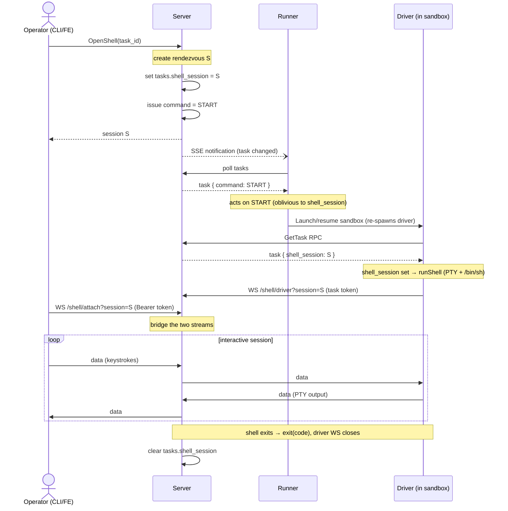

# Driver reverse shell

Issue: https://github.com/icholy/gritz/issues/1110

## Problem

`gritz shell` talks directly to the local Docker daemon: it finds the task's
container by the `gritz.task=<id>` label and `docker exec -it`
(`internal/command/shell.go`). That assumes the CLI runs on the same host as the
daemon, the Docker naming/label convention, and a single backend. None of that
survives hosted/remote runners or non-Docker backends (Lambda MicroVMs today,
k8s/Fly later): the sandbox isn't reachable from the operator's machine, there's
no local socket, and each backend exposes shells differently.

We want an interactive shell into a task's sandbox **regardless of backend or
where the runner lives**, primarily for debugging ("look around and see what went
wrong"), including into a **finished** task's preserved filesystem — not just a
running one.

## Design

### Principle: the driver is the shell, the server is the rendezvous

The sandbox is egress-only and the operator's terminal (browser tab or laptop
CLI) isn't reachable either — so **both ends dial into the server**, which bridges
the two streams. Rather than reach into each backend's substrate (`docker exec`,
the AWS `create-microvm-shell-auth-token` + `SHELL_INGRESS` path, `kubectl exec`,
…), the **driver** — the one component present in every sandbox, already holding
an authenticated connection to the server via the task token — implements the shell.
One implementation, every backend, no substrate credentials, and the existing
egress-only path already works through NAT.

### A sandbox run is one mode, chosen once

Each time a sandbox is running it is doing exactly one of two things: running the
agent, or serving a shell. They are mutually exclusive. The driver reads the task
at startup (`internal/agent/driver.go` `run()`) and forks into one path; there is
no concurrent watcher and no attach-to-a-running-agent.

### Data model: a `shell_session` field on the task (commands unchanged)

The obvious carrier — `TaskCommand` (`NONE/RESTART/STOP/START`, proto field 10) —
does **not** work: it is transient and runner-owned. The runner consumes it and
clears it to `NONE` as part of bringing the sandbox up, which happens *before*
the driver exists to read the task. By the time the driver calls `get_my_task`,
the command is already gone.

So commands stay exactly as they are (runner-only lifecycle), and we add a
separate, persistent, nullable field the runner never touches:

Proto (`proto/gritz/v1/gritz.proto`, `Task` message, next free field is 16):

```proto
message Task {
  // ... fields 1-15 unchanged ...
  string shell_session = 16;  // non-empty => this run is a shell for this rendezvous
}
```

Migration (`internal/store/sql/migrations/`, dbmate):

```sql
-- migrate:up
ALTER TABLE tasks ADD COLUMN shell_session text NOT NULL DEFAULT '';

-- migrate:down
ALTER TABLE tasks DROP COLUMN shell_session;
```

The field does double duty: it is both the **mode selector** (set = shell run)
and the **rendezvous id** (which session the driver should dial). The runner and
the whole command FSM are oblivious to it.

### Driver: fork at startup

```
task := getTask()
if task.ShellSession != "" {
    runShell(task.ShellSession)   // allocate PTY, spawn /bin/sh, dial the rendezvous
} else {
    runAgent()                    // existing path: setup commands + agent
}
```

`runShell` allocates a PTY, spawns a login shell, and connects a WebSocket to the
server for `shell_session`, piping the PTY master over it.

### Runner: unchanged, and deliberately oblivious

The runner keeps doing only lifecycle (`Start/Stop/Restart`) plus uniform sandbox
supervision. It does not read `shell_session`. Crucially, the sandbox lifecycle
events ("Sandbox started", "Sandbox exited (… -> …)") describe the **sandbox
run**, not the agent — so a shell run emits the identical events, and a shell run
that errors surfaces as "failed" in the timeline exactly like an agent run. No
shell-specific exit handling in the runner. Shell and agent runs are
indistinguishable in the timeline for now; tagging the run type is a possible
later refinement.

### Orchestration

Open a shell for task `N`:

1. The server creates a rendezvous session `S` (server-side registry) for the task.
2. The server sets `tasks.shell_session = S`, **then** issues a normal `START`/`RESTART`.
   Ordering matters: the field must be set before the sandbox boots, since the
   driver reads it once.
3. The runner brings the sandbox up (obliviously; `Launch`/resume re-spawns the
   driver against the preserved disk for a finished task).
4. The re-spawned driver reads `shell_session`, forks into `runShell`, dials the
   server WebSocket for `S`.
5. The operator's client dials the server WebSocket for `S`, authenticated with a
   Bearer token (see Security); the server bridges the two.



Close: when the session ends — the shell exits and the driver's WebSocket drops —
the server observes the rendezvous teardown and clears `shell_session` itself. Neither
the driver nor the runner ever writes the field, so the next `START` is a plain
agent run.

The rendezvous has a connection-establishment timeout: if both legs — driver and
operator — are not connected within it, the session is deleted and any
already-connected client is disconnected. The attach leg is single-occupancy —
at most one operator is bridged to a session at a time.

### Transport: WebSocket on both legs, server as a byte-relay

Both legs are client-initiated WebSockets to the server; the server is a **mode-agnostic
byte pump** that only tracks session lifecycle and copies frames verbatim. WS
(not Connect bidi streaming) because the web FE is a wanted-eventually consumer
and browsers cannot do client/bidi streaming over Connect — WS + xterm.js is the
only browser-native option, and using WS for both legs keeps the server bridge
symmetric.

New server endpoints (alongside the existing Connect handler and the raw `/events`
SSE endpoint in `internal/server/server.go`):

- Connect RPC `OpenShell(task_id) -> {session_id}` — creates `S`, sets
  `shell_session`, issues the lifecycle command, returns the session id.
- `GET /shell/driver?session=<id>` (WebSocket) — the driver leg, authed with the
  task token.
- `GET /shell/attach?session=<id>` (WebSocket) — the operator leg, authed with a
  Bearer token; the caller's org comes from its token claims (`caller.OrgID`).

**Framing** is an end-to-end contract between driver and client (the server does not
parse it): **binary** WS frames, `[1-byte type][payload]`:

- `0x00 data`   — raw PTY bytes (a PTY master is one combined stream)
- `0x01 resize` — rows/cols (SIGWINCH -> TIOCSWINSZ on the driver)
- `0x02 exit`   — shell exit code
- `0x03 ping`   — keepalive

The subprotocol negotiates a version only:
`Sec-WebSocket-Protocol: gritz-shell.v1`. Operator-leg auth is a Bearer token on
the request, not the subprotocol.

Both legs use `github.com/coder/websocket`. The session registry is in-memory,
which assumes a single server instance; cross-instance rendezvous (routing both legs
to the session owner, or a shared bus) is out of scope for v1 and dealt with if
and when the server is horizontally scaled.

### CLI

`gritz shell <task>` is reimplemented against the server: call `OpenShell`, connect
the `/attach` WebSocket, put the local terminal in raw mode, and pump frames. The
Docker-direct implementation in `internal/command/shell.go` is removed. Result:
one command that works for every backend and for remote runners.

### Security

This is, deliberately, a driver-hosted debug shell present in every sandbox. It
runs as the driver (root inside the sandbox) and can see the repo and any
injected tokens. It must be gated accordingly:

- server-side authorization on who may `OpenShell` for a given task/org.
- The operator (attach) leg reuses the existing auth system rather than a bespoke
  credential: it authenticates with a Bearer token and takes the org from the
  token claims (`caller.OrgID`), the same mechanism the Connect API already uses.
  Attach is authorized iff the caller belongs to the org that owns the session's
  task. The trust boundary is therefore the **org**: any member of the task's org
  may attach (one at a time — the attach leg is single-occupancy). The session id
  is not a secret — it is persisted in `shell_session` and returned by `GetTask`
  — so access control is by org membership, not by possession of the id.
- The driver leg is authed with the task token, bound to the session's
  task so an authenticated driver cannot seize another task's session.
- Audit (who attached, when) and optional session recording — free, since the server
  is in the byte path.
- WS ping/pong + a hard idle/max-session timeout, so a forgotten shell does not
  keep a billed microVM resumed indefinitely.

### Web-FE-later, without a corner

v1 is CLI-only and authenticates the attach leg with a Bearer token. The wire
contract is deliberately frozen so the browser can be added later as just another
client: WS both legs, **binary** frames (terminal output isn't UTF-8-safe),
language-neutral `[type][payload]` framing (no Go-specific codec), versioned
`gritz-shell.v1`, and a relay/driver that never know who is attached. The
browser's one wrinkle — it can't set an `Authorization` header on a WebSocket —
has a known solution (cookie auth plus an org query parameter, as other endpoints
already do), so the web terminal stays a straightforward later addition rather
than a corner. Working out those details is deferred.

## Trade-offs

- **Driver-implemented vs. substrate-native** (`docker exec`, AWS shell token +
  `SHELL_INGRESS`, `kubectl exec`). Driver wins on backend-agnosticism, reuse of
  the existing egress-only authenticated connection, and needing no substrate
  credentials or per-backend integration. The cost: it only works while the
  driver is alive. Resume-to-respawn covers finished tasks (the filesystem is
  preserved); a **dead driver or wedged sandbox cannot be served** — that is an
  accepted non-goal, and the one place a substrate-native break-glass path would
  still be needed if we ever want it.
- **Separate `shell_session` field vs. overloading `command`.** `command` is
  cleared by the runner before the driver can read it; a separate persistent
  field is the only thing that reaches the driver, and it keeps the runner and
  the command FSM completely unchanged.
- **WebSocket vs. Connect bidi streaming.** Connect bidi is in-framework and fine
  for a Go CLI, but `connect-web`/`grpc-web` have no browser bidi, which strands
  the wanted web terminal. WS both legs is browser-ready and symmetric.
- **Existing auth vs. a bespoke ticket for the operator leg.** The CLI sets a
  Bearer header, so the existing auth system already covers the operator leg; a
  single-use ticket would add a parallel credential system for no benefit. (The
  browser can't set that header, but it has a known cookie-based path, deferred
  with the rest of the web work.) The cost is that the trust boundary is the org
  (any org member may attach), not a per-session capability; given `OpenShell` is
  itself authorized and the attach leg is single-occupancy, that is an accepted
  simplification.

## Open Questions

- **Idle/max-session timeout defaults** for an established session, given a live
  shell holds a resumed (billed) microVM. (Distinct from the connection-
  establishment timeout above, which is decided.)