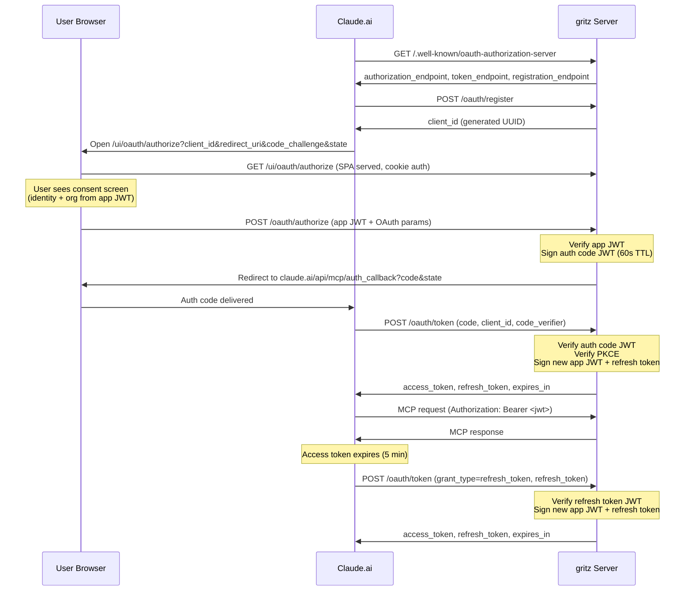

# OAuth 2.1 for MCP endpoint

Issue: https://github.com/icholy/gritz/issues/417

## Problem

The `/mcp` endpoint cannot be used as a Claude.ai custom connector because Claude.ai requires OAuth 2.1 authorization code flow with PKCE. The current auth mechanisms (API key with `X-Auth-Type` header, Zitadel Bearer tokens, cookie sessions) are not compatible with Claude.ai's connector UI.

## Design

### Overview

Implement a minimal OAuth 2.1 authorization server within gritz. The user is already logged into the gritz web UI and has an app JWT (from `/auth/token`) scoped to their selected org. The authorize page sends this JWT to the backend, which verifies it and issues an auth code. No API keys or cookie auth involved in the OAuth flow.

### Sequence Diagram



### New Routes

| Method | Path | Auth | Description |
|--------|------|------|-------------|
| GET | `/.well-known/oauth-authorization-server` | Public | RFC 8414 metadata |
| GET | `/.well-known/oauth-protected-resource` | Public | RFC 9728 resource metadata |
| POST | `/oauth/register` | Public | Stub DCR -- returns a generated client_id |
| POST | `/oauth/authorize` | App JWT | Verifies JWT, issues auth code, redirects |
| POST | `/oauth/token` | Public | Exchanges auth code for app JWT |

The `GET /ui/oauth/authorize` page is handled by the React frontend. The backend only handles the `POST`.

### Discovery Metadata

`GET /.well-known/oauth-authorization-server` returns:

```json
{
  "issuer": "https://gritz.example.com",
  "authorization_endpoint": "https://gritz.example.com/ui/oauth/authorize",
  "token_endpoint": "https://gritz.example.com/oauth/token",
  "response_types_supported": ["code"],
  "grant_types_supported": ["authorization_code", "refresh_token"],
  "code_challenge_methods_supported": ["S256"],
  "registration_endpoint": "https://gritz.example.com/oauth/register"
}
```

`GET /.well-known/oauth-protected-resource` returns:

```json
{
  "resource": "https://gritz.example.com",
  "authorization_servers": ["https://gritz.example.com"]
}
```

### Registration Endpoint (Stub DCR)

`POST /oauth/register` accepts a JSON body per [RFC 7591](https://datatracker.ietf.org/doc/html/rfc7591). The endpoint ignores most fields and returns a generated `client_id` (UUID) with no `client_secret`. This allows Claude.ai to automatically obtain a client_id without the user configuring one manually.

```json
// Request (most fields ignored)
{
  "client_name": "Claude",
  "redirect_uris": ["https://claude.ai/api/mcp/auth_callback"]
}

// Response
{
  "client_id": "<generated-uuid>",
  "client_name": "Claude",
  "redirect_uris": ["https://claude.ai/api/mcp/auth_callback"]
}
```

The client_id is not persisted -- it's only used for consistency checks between the authorize and token steps. Any valid UUID works.

### Authorization Endpoint

**Frontend (`/ui/oauth/authorize`)**: React page that reads the OAuth query params (`client_id`, `redirect_uri`, `state`, `code_challenge`, `code_challenge_method`, `response_type`). Shows a consent screen with the user's identity and org. On approve, POSTs the OAuth params plus the app JWT (from the existing auth context) to `/oauth/authorize`.

**Backend (`POST /oauth/authorize`)**: Verifies the app JWT from the request body via `VerifyAppToken()`. On success, signs an auth code JWT containing the user/org identity and OAuth params, then redirects to `redirect_uri?code=<code>&state=<state>`.

### Token Endpoint

`POST /oauth/token` accepts `application/x-www-form-urlencoded`:

| Parameter | Description |
|-----------|-------------|
| `grant_type` | Must be `authorization_code` |
| `code` | The auth code from the authorize step |
| `client_id` | Must match the authorize request |
| `code_verifier` | PKCE verifier matching the original `code_challenge` |
| `redirect_uri` | Must match the original `redirect_uri` |

`client_secret` is accepted but ignored -- PKCE is the sole proof of authorization.

**`grant_type=authorization_code`** validation:
1. Verify the auth code JWT signature and expiry
2. Verify `client_id` and `redirect_uri` match the JWT claims
3. Verify `code_verifier` against the JWT's `code_challenge` (SHA256)

**`grant_type=refresh_token`** validation:
1. Verify the refresh token JWT signature and expiry

Both grant types return the same response shape. On success, sign a new app JWT and a new refresh token using `SignAppToken()` with the `UserInfo` from the auth code or refresh token:

```json
{
  "access_token": "<jwt>",
  "token_type": "Bearer",
  "expires_in": 300,
  "refresh_token": "<jwt>"
}
```

The refresh token is a signed JWT with the same user/org claims as the access token but with a longer TTL (30 days). Each refresh rotates the refresh token -- a new one is issued every time. Refresh tokens cannot be revoked before expiry since there is no server-side state.

### Auth Code as Signed JWT

Auth codes are self-contained signed JWTs (60s TTL) containing all the state the token endpoint needs. This avoids shared state between server instances.

The auth code JWT uses the existing Ed25519 `AppKey` for signing:

```go
type authCodeClaims struct {
    jwt.RegisteredClaims
    // User identity from the app JWT
    Email         string `json:"email"`
    Name          string `json:"name"`
    OrgID         int64  `json:"org_id"`
    // OAuth params that must match at the token endpoint
    ClientID      string `json:"client_id"`
    RedirectURI   string `json:"redirect_uri"`
    CodeChallenge string `json:"code_challenge"`
}
```

The `POST /oauth/authorize` handler verifies the app JWT, extracts the user identity, and creates this auth code JWT. The `POST /oauth/token` handler verifies the signature, checks expiry, and validates the PKCE and OAuth params against the claims.

Since the code is signed and has a 60s TTL, replay is limited to the expiry window. Single-use enforcement is not possible without shared state, but the short TTL and PKCE `code_verifier` requirement make replay impractical.

No database migration needed. No shared state between instances.

### MCP Endpoint Auth Change

The `/mcp` endpoint currently requires the `X-Auth-Type` header to determine auth strategy. Claude.ai sends a plain `Authorization: Bearer <token>` with no custom headers.

Modify the `RequireAuth` middleware's default case (no `X-Auth-Type` header): after cookie auth fails, attempt app JWT validation via `VerifyAppToken()`. This allows the MCP endpoint to accept app JWTs issued by the OAuth token endpoint without any custom headers.

```go
// In RequireAuth, the default case (no X-Auth-Type header):
default:
    if !a.useDevUser(w, r, next) {
        // Try cookie auth first
        // If no cookie session, try app JWT from Bearer header
        // Fall back to cookie middleware (which will redirect to login)
    }
```

### New Package

`internal/oauthflow/` containing:

- `oauthflow.go` -- `Server` struct, `Options`, `New()` constructor
- `code.go` -- auth code JWT claims, sign/verify helpers
- `handlers.go` -- HTTP handlers for all 4 endpoints

The `Server` struct takes:

```go
type Options struct {
    AppKey  ed25519.PrivateKey
    BaseURL string
}
```

All dependencies are existing types. No new store queries or proto changes. `KeyValidator` is no longer needed.

### Route Registration in `server.go`

```go
oauthFlow := oauthflow.New(mcpauth.Options{
    AppKey:  appKey,
    BaseURL: s.baseURL,
})
mux.HandleFunc("/.well-known/oauth-authorization-server", oauthFlow.HandleMetadata)
mux.HandleFunc("/.well-known/oauth-protected-resource", oauthFlow.HandleResourceMetadata)
mux.HandleFunc("/oauth/register", oauthFlow.HandleRegister)
mux.HandleFunc("/oauth/authorize", oauthFlow.HandleAuthorize)
mux.HandleFunc("/oauth/token", oauthFlow.HandleToken)
```

All routes are public -- no auth middleware needed. The `/oauth/authorize` POST authenticates via the app JWT in the request body.

### Frontend Route

New React route at `webui/src/routes/oauth.authorize.tsx` (maps to `/ui/oauth/authorize`):

- Reads OAuth query params from the URL
- Shows the user's identity and org (from the existing auth context)
- Has an "Approve" button that POSTs the OAuth params + app JWT to `/oauth/authorize`
- Shows error state if the POST fails

This page is behind cookie auth middleware (like all `/ui/` routes). The user must be logged in and have an org selected to have a valid app JWT.

### User Flow

1. User adds a custom connector in Claude.ai with:
   - **URL**: `https://gritz.example.com/mcp`
   - **Client ID / Client Secret**: leave blank (Claude.ai auto-registers via DCR)
2. Claude.ai fetches discovery metadata, registers via `/oauth/register`, opens browser to `/ui/oauth/authorize`
3. If user is not logged into gritz, they log in via Zitadel (existing SSO flow)
4. User sees a consent screen showing their identity and org, clicks "Approve"
5. Frontend POSTs app JWT + OAuth params to `/oauth/authorize`
6. Backend verifies JWT, signs auth code JWT, redirects back to Claude.ai
7. Claude.ai exchanges the code at `/oauth/token` (PKCE verified) for a new app JWT
8. Claude.ai uses the JWT as Bearer token on `/mcp`

## Trade-offs

### Auth code as signed JWT vs. shared store

Auth codes are self-contained signed JWTs rather than random tokens looked up in a database or cache. This avoids shared state between server instances -- any instance can verify the code using the shared `AppKey`. The tradeoff is that single-use enforcement is not possible (a code could theoretically be replayed within its 60s TTL), but PKCE makes this impractical since the attacker would also need the `code_verifier`.

### Stub DCR vs. persistent client registry

The `/oauth/register` endpoint generates a UUID but doesn't persist it. The client_id is only checked for consistency between the authorize and token steps (it's embedded in the auth code JWT). A persistent `oauth_clients` table would enable revocation, UI visibility of connected clients, and per-client configuration, but isn't needed for the initial implementation.

### Refresh tokens are not revocable

Refresh tokens are signed JWTs with a 30-day TTL and no server-side state. They cannot be revoked before expiry. This is acceptable because the tokens are scoped to a single user/org and the threat model is low -- a leaked refresh token grants the same access as a leaked API key. If revocation becomes necessary, a database-backed revocation list can be added later.

## Open Questions

1. **OAuth query param preservation across login redirect**: When an unauthenticated user hits `/ui/oauth/authorize`, the cookie auth middleware redirects to Zitadel login. After login, the user needs to land back at `/ui/oauth/authorize` with the original OAuth query params intact. Need to verify that the existing Zitadel redirect flow preserves the full original URL including query params.