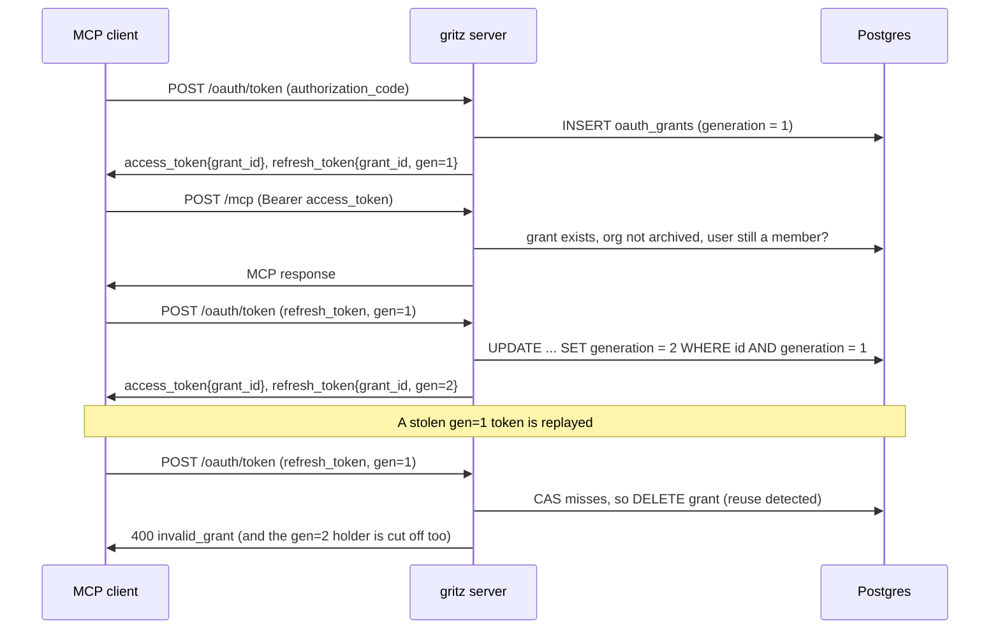

# List and revoke MCP OAuth clients

Issue: https://github.com/gritzapp/gritz/issues/2070

## Problem

The OAuth 2.1 flow behind `/mcp` (`internal/auth/oauthflow`, see
`proposals/implemented/mcp-oauth.md`) keeps no server-side state. The refresh token
is an Ed25519-signed JWT (`refreshTokenClaims`) with a 30-day TTL, and each refresh
issues a new one. So a connected client stays authorized until one of these happens:

- it goes unused for 30 days,
- the user leaves the org, or the org is archived (`ResolveOrg` runs on refresh),
- `--auth-app-key` changes, which signs everyone out of everything.

A user can't see which clients are connected, and can't revoke one. A leaked
refresh token stays valid for as long as somebody keeps refreshing it, and the
legitimate client keeps working alongside it, so nobody notices.

This proposal covers the second half of #2070. The missing `WWW-Authenticate`
header on `/mcp` is a separate change.

## Design

### Overview

Every successful authorization-code exchange creates a **grant** row: one user,
one org, one OAuth client. The refresh token stops carrying identity. It becomes a
signed pointer to its grant (`grant_id`) plus a rotation counter (`gen`). The
grant row is the source of truth: deleting it revokes the client. Access tokens
carry the `grant_id` too, and bearer auth checks that the grant still exists, so
revocation also cuts off the current access token right away. Users list and
revoke their grants through two new RPCs and a new **MCP clients** page.



### Schema

A new Postgres migration, `internal/store/sql/migrations/<ts>_oauth_grants.sql`:

```sql
-- migrate:up

-- One row per authorized MCP OAuth client: a user, acting in an org, through a
-- client. Deleting the row revokes the client. See
-- proposals/draft/revocable-mcp-oauth-clients.md.
CREATE TABLE oauth_grants (
    id           TEXT PRIMARY KEY,           -- uuid, the refresh/access token's grant_id
    org_id       BIGINT NOT NULL REFERENCES orgs(id) ON DELETE CASCADE,
    user_id      TEXT NOT NULL REFERENCES users(id) ON DELETE CASCADE,
    client_id    TEXT NOT NULL,              -- the DCR client_id from /oauth/register
    redirect_uri TEXT NOT NULL,              -- shown as the client's label (its host)
    generation   BIGINT NOT NULL,            -- current refresh token's gen
    created_at   TIMESTAMP NOT NULL,
    refreshed_at TIMESTAMP NOT NULL,         -- last token issue; doubles as "last active"
    expires_at   TIMESTAMP NOT NULL          -- refreshed_at + refresh token TTL
);
CREATE INDEX idx_oauth_grants_org_user ON oauth_grants(org_id, user_id);
CREATE INDEX idx_oauth_grants_expires_at ON oauth_grants(expires_at);

-- migrate:down

DROP TABLE oauth_grants;
```

The server runs only on Postgres, so there is no SQLite migration. Notes on the
columns:

- `generation` replaces storing token hashes. The refresh token is still a signed
  JWT, so the server doesn't need to look it up by hash. It only needs to know
  whether the presented token is the newest one. A counter tells it that, and also
  catches replay of *any* older token, not just the one right before.
- There is no `revoked_at`. Revoking a grant deletes the row, the same way
  `DeleteKey` deletes a key. Revoking and reuse detection both just delete.
- `expires_at` slides forward on every refresh, matching the refresh token's
  `exp`. Expired rows are hidden from the list and swept up by the archiver (see
  [Expiry sweep](#expiry-sweep)).
- `client_name` is not stored. The stub DCR endpoint never persists it, and the
  authorize/token requests don't carry it. Instead the UI labels a grant by its
  `redirect_uri` host: `claude.ai`, `localhost:33418`, and so on. See
  [Open Questions](#open-questions).

Queries in `internal/store/sql/queries/oauth_grant.sql`:

```sql
-- name: CreateOAuthGrant :exec
INSERT INTO oauth_grants (id, org_id, user_id, client_id, redirect_uri, generation,
                          created_at, refreshed_at, expires_at)
VALUES ($1, $2, $3, $4, $5, 1, $6, $6, $7);

-- name: RotateOAuthGrant :one
-- Compare-and-swap on the generation. No row comes back if the grant is gone,
-- expired, or gen is stale (a reused refresh token).
UPDATE oauth_grants
SET generation = generation + 1, refreshed_at = $3, expires_at = $4
WHERE id = $1 AND generation = $2 AND expires_at > $3
RETURNING id, org_id, user_id, client_id, redirect_uri, generation,
          created_at, refreshed_at, expires_at;

-- name: CheckOAuthGrant :one
-- Bearer auth's per-request check for OAuth-issued access tokens. A grant whose
-- org is archived, or whose user has left the org, matches nothing.
SELECT EXISTS (
    SELECT 1 FROM oauth_grants g
    JOIN orgs o ON o.id = g.org_id
    JOIN org_members m ON m.org_id = g.org_id AND m.user_id = g.user_id
    WHERE g.id = $1 AND g.expires_at > $2 AND o.archived = FALSE
);

-- name: ListOAuthGrants :many
SELECT id, org_id, user_id, client_id, redirect_uri, generation,
       created_at, refreshed_at, expires_at
FROM oauth_grants
WHERE org_id = $1 AND user_id = $2 AND expires_at > $3
ORDER BY refreshed_at DESC;

-- name: DeleteOAuthGrant :execrows
-- Scoped by user and org: users revoke only their own grants.
DELETE FROM oauth_grants WHERE id = $1 AND org_id = $2 AND user_id = $3;

-- name: DeleteOAuthGrantByID :exec
-- Reuse detection, where the token endpoint has no caller to scope by.
DELETE FROM oauth_grants WHERE id = $1;

-- name: DeleteExpiredOAuthGrants :execrows
DELETE FROM oauth_grants WHERE expires_at <= $1;
```

`model.OAuthGrant` mirrors the row and has a `Proto()` method, following the
same pattern as `model.Key`.

### Refresh token and rotation

`refreshTokenClaims` loses its identity fields:

```go
// refreshTokenClaims are the JWT claims for a refresh token.
type refreshTokenClaims struct {
	jwt.RegisteredClaims        // ExpiresAt = grant.expires_at
	TokenType string `json:"token_type"` // "refresh_token"
	GrantID   string `json:"grant_id"`
	Gen       int64  `json:"gen"`
}
```

`verifyRefreshToken` rejects a token with an empty `grant_id`. The user's ID,
email, name and org now come from the grant row and the `users` table. That also
means a renamed user gets fresh claims on the next refresh rather than the name
from 30 days ago.

**Code exchange** (`handleAuthCodeGrant`): after the existing PKCE and parameter
checks, call `ResolveOrg` (as the refresh path does today). Then insert a grant
with `generation = 1` and issue tokens for it.

**Refresh** (`handleRefreshTokenGrant`):

1. Verify the JWT signature, `exp` and `token_type`, and read `grant_id` and `gen`.
2. `RotateOAuthGrant(grant_id, gen, now, now+ttl)`. If that returns a row, issue
   an access token and a `gen+1` refresh token for it. Done.
3. If there's no row, the token is either revoked/expired or **reused**. Either
   way, `DeleteOAuthGrantByID(grant_id)` and respond with `invalid_grant`. When
   the grant still existed, that delete is the reuse-detection response that
   OAuth 2.1 §4.3.1 recommends: a stale token means two parties hold the token
   chain, and the server can't tell which one is the thief, so it revokes both.
   Log it at warn level with `grant_id`, `user_id` and `org_id` (read before
   deleting).

The CAS makes concurrent refreshes safe without `SELECT ... FOR UPDATE`. Exactly
one request with a given `gen` wins. Any other request for the same grant counts
as reuse.

The `ResolveOrg` call on refresh goes away. `CheckOAuthGrant`'s joins enforce
org archival and membership on every request, which is stricter, so the refresh
path doesn't need to repeat it. `RotateOAuthGrant` joins nothing, so after
`RotateOAuthGrant` the refresh path runs `CheckOAuthGrant` once before it issues
tokens. That way it won't mint tokens that the next request would refuse.

### Token endpoint errors

Today every failure is a plain-text `http.Error(..., 400)`. Clients only restart
the authorization flow when they recognize the error, so the token endpoint
switches to RFC 6749 §5.2 JSON bodies: `{"error": "invalid_grant"}` for any
bad, expired, revoked or reused code or refresh token, `invalid_request` for
missing parameters, and `unsupported_grant_type`. A small `writeTokenError(w,
code)` helper replaces the `http.Error` calls in `HandleToken` and its two grant
handlers.

### Access tokens

`issueTokens` stamps the grant on the access token. `AppClaims` gains a field:

```go
	// GrantID is set on app JWTs issued by the OAuth token endpoint; bearer
	// auth rejects the token once its oauth_grants row is gone.
	GrantID string `json:"grant_id,omitempty"`
```

`apiauth.Auth.authenticate` checks the grant on every app JWT that carries one:

```go
	claims, err := VerifyAppToken(a.appKey, raw)
	...
	if claims.GrantID != "" {
		if err := a.grants.CheckGrant(r.Context(), claims.GrantID); err != nil {
			return nil, err // → 401, so the client refreshes and gets invalid_grant
		}
	}
```

The check is one primary-key lookup with two joins. API-key auth already pays
that cost (`GetKeyByHash`) on every request. Web UI app JWTs (`/auth/token`) and
task tokens don't carry `grant_id`, so they skip the check and behave as they do
today. This makes revocation take effect right away on both paths:

| Revocation trigger | Refresh token | Access token in flight |
| --- | --- | --- |
| User revokes in the UI | `invalid_grant` | 401 on the next request |
| Reuse detected | `invalid_grant` | 401 on the next request |
| User removed from org / org archived | `invalid_grant` (grant row stays) | 401 on the next request |
| Org deleted / user deleted | FK cascade deletes the grant | 401 on the next request |
| 30 days unused | `exp` and `expires_at` | already expired (5 min TTL) |
| `--auth-app-key` changes | signature fails | signature fails |

If a removed member is re-added, a grant that hasn't expired works again. That
matches the behaviour of their other credentials. `RemoveOrgMember` could
delete the user's grants for that org, but nothing depends on it. See
[Open Questions](#open-questions).

### Expiry sweep

The archiver (`internal/server/archiver`) already ticks every minute. Each tick
also runs `DeleteExpiredOAuthGrants(now)` and logs the count when it's non-zero.
Correctness doesn't depend on the sweep: every query already filters on
`expires_at`. The sweep only stops the table from growing without bound.

### API

Two RPCs on `GritzService` in `proto/gritz/v1/gritz.proto`, next to the key RPCs:

```proto
  rpc ListOAuthGrants(ListOAuthGrantsRequest) returns (ListOAuthGrantsResponse);
  rpc RevokeOAuthGrant(RevokeOAuthGrantRequest) returns (RevokeOAuthGrantResponse);

// An MCP client the caller authorized through OAuth in the current org.
message OAuthGrant {
  string id = 1;
  string client_id = 2;
  string redirect_uri = 3;
  google.protobuf.Timestamp created_at = 4;
  google.protobuf.Timestamp refreshed_at = 5;  // last token issued: "last active"
  google.protobuf.Timestamp expires_at = 6;
}

message ListOAuthGrantsRequest {}

message ListOAuthGrantsResponse {
  repeated OAuthGrant grants = 1;
}

message RevokeOAuthGrantRequest {
  string id = 1;
}

message RevokeOAuthGrantResponse {}
```

The handlers live in `internal/server/apiserver/oauth_grant.go`:

- Both handlers require a user caller (`caller.ID != ""`). An API key has no
  user, so it gets `PermissionDenied`.
- They gate on new scope ops `authscope.OpOAuthGrantRead` /
  `OpOAuthGrantWrite` (`{"oauth_grant", "read"|"write"}`). The admin wildcard
  that app JWTs carry covers both.
- Both are scoped to `(caller.OrgID, caller.ID)`. Users see and revoke their own
  clients in the selected org, and never anyone else's. `RevokeOAuthGrant` on an
  unknown ID returns `NotFound` (from `:execrows`).
- Both publish a `change` notification with resource type `oauth_grants`, so an
  open page in another tab refreshes. This follows the same pattern as
  `CreateKey`/`DeleteKey`.

An MCP client can revoke itself through the API, since its token carries the
admin wildcard. That's harmless, and it isn't exposed as an MCP tool.

### Go API

```go
package oauthflow // github.com/gritzapp/gritz/internal/auth/oauthflow

// GrantStore persists OAuth grants.
type GrantStore interface { // new
	// CreateGrant inserts g with generation 1.
	CreateGrant(ctx context.Context, g *model.OAuthGrant) error
	// RotateGrant advances the grant from gen to gen+1 and slides its expiry;
	// it returns sql.ErrNoRows if the grant is gone, expired or gen is stale.
	RotateGrant(ctx context.Context, id string, gen int64, expiresAt time.Time) (*model.OAuthGrant, error)
	// DeleteGrant removes the grant regardless of owner.
	DeleteGrant(ctx context.Context, id string) error
	// CheckGrant returns an error unless the grant is live and its user is still
	// a member of its non-archived org.
	CheckGrant(ctx context.Context, id string) error
	// GetUser returns the grant's user, for the access token's email and name.
	GetUser(ctx context.Context, id string) (*model.User, error)
}

type Options struct {
	AppKey          ed25519.PrivateKey
	OrgResolver     OrgResolver
	Grants          GrantStore // new
	BaseURL         string
	AuthCodeTTL     time.Duration
	RefreshTokenTTL time.Duration
}
```

```go
package apiauth // github.com/gritzapp/gritz/internal/auth/apiauth

// AppClaims gains:
	// GrantID is set on app JWTs issued by the OAuth token endpoint.
	GrantID string `json:"grant_id,omitempty"` // new

// GrantChecker validates the OAuth grant behind an access token.
type GrantChecker interface { // new
	// CheckGrant returns an error unless the grant is live.
	CheckGrant(ctx context.Context, id string) error
}

type Config struct {
	...
	GrantChecker GrantChecker // new
}
```

```go
package store // github.com/gritzapp/gritz/internal/store

// CreateOAuthGrant inserts g with generation 1 and sets its timestamps.
func (s *Store) CreateOAuthGrant(ctx context.Context, tx *sql.Tx, g *model.OAuthGrant) error

// RotateOAuthGrant advances the grant's generation if gen is current.
func (s *Store) RotateOAuthGrant(ctx context.Context, tx *sql.Tx, id string, gen int64, now, expiresAt time.Time) (*model.OAuthGrant, error)

// CheckOAuthGrant reports whether the grant is live for a member of a live org.
func (s *Store) CheckOAuthGrant(ctx context.Context, tx *sql.Tx, id string, now time.Time) (bool, error)

// ListOAuthGrants returns the user's unexpired grants in the org, most recently active first.
func (s *Store) ListOAuthGrants(ctx context.Context, tx *sql.Tx, orgID int64, userID string, now time.Time) ([]*model.OAuthGrant, error)

// DeleteOAuthGrant deletes the user's grant in the org and reports whether it existed.
func (s *Store) DeleteOAuthGrant(ctx context.Context, tx *sql.Tx, id string, orgID int64, userID string) (bool, error)

// DeleteOAuthGrantByID deletes a grant regardless of owner.
func (s *Store) DeleteOAuthGrantByID(ctx context.Context, tx *sql.Tx, id string) error

// DeleteExpiredOAuthGrants deletes grants that expired by now and returns how many.
func (s *Store) DeleteExpiredOAuthGrants(ctx context.Context, tx *sql.Tx, now time.Time) (int64, error)
```

```go
package server // github.com/gritzapp/gritz/internal/server

// StoreGrantStore implements oauthflow.GrantStore and apiauth.GrantChecker using the store.
type StoreGrantStore struct{ ... } // new

// NewStoreGrantStore returns a StoreGrantStore backed by s.
func NewStoreGrantStore(s *store.Store) *StoreGrantStore // new
```

**How it fits:** `internal/command/server.go` constructs one `StoreGrantStore`,
the same way it builds `StoreKeyValidator`. It passes the store to
`oauthflow.New` as `Grants` and to `apiauth.New` as `GrantChecker`. The token
endpoint calls `CreateGrant`/`RotateGrant`/`DeleteGrant`. Bearer auth calls
`CheckGrant` for app JWTs that carry `grant_id`. The apiserver handlers call
the `store` methods directly, as the key handlers do. The archiver calls
`DeleteExpiredOAuthGrants` each tick.

### Web UI

A new route, `webui/src/routes/mcp-clients.index.tsx` (`/ui/mcp-clients`), is
modelled on `keys.index.tsx`:

- A table of the caller's grants in the selected org. The columns are
  **Client** (the `redirect_uri` host, with the full URI and `client_id` in a
  tooltip), **Connected** (`created_at`), **Last active** (`refreshed_at`,
  relative) and **Expires** (`expires_at`).
- A **Revoke** button on each row, behind a confirmation dialog. It calls
  `RevokeOAuthGrant` and invalidates the list query.
- An empty state that explains how to connect a client and links to the docs.
- A sidebar entry next to Keys, and a link from the **MCP** card on the
  Settings page ("Manage connected clients").

The consent page (`oauth.authorize.tsx`) also shows the `redirect_uri` host, so
the label the user sees on the MCP clients page matches the one they approved.

### Docs

The behaviour change is visible to users, so the same PRs update
`docs/src/content/docs/integrations/mcp.md`:

- The paragraph at line 70 gains "or if you revoke it" and a link to the MCP
  clients page.
- A short **Revoking a client** subsection covers what revocation does: the
  client is cut off immediately and must sign in again. It also explains reuse
  detection: replaying an old refresh token revokes the client.

### Clients connected at deploy time

No backwards compatibility, per CLAUDE.md:

- **Refresh tokens** issued before the deploy have no `grant_id`, so
  `verifyRefreshToken` rejects them with `invalid_grant`. Every OAuth-connected
  client has to go through the authorize flow once more. Claude.ai and Claude
  Code do this on `invalid_grant`. Others show "reconnect".
- **Access tokens** issued before the deploy have no `grant_id`, so they look
  like web UI app JWTs and keep working until they expire, at most 5 minutes
  (`AppTokenTTL`). No special handling.
- **The table** starts empty. Nothing is backfilled, because the server never
  recorded who was connected.

The docs PR and the release notes say so: "MCP clients connected through OAuth
need to sign in again once."

## Implementation Plan

1. **Schema + store** — Delivers: the `oauth_grants` migration, the
   `oauth_grant.sql` queries, the sqlc output, `model.OAuthGrant` and the `store`
   methods. Depends on: nothing. Verifiable by: store tests against Postgres,
   covering the CAS rotation (current gen wins, stale gen misses, expired misses),
   the `CheckOAuthGrant` joins (archived org, removed member), owner-scoped delete
   and the expiry delete. It is safe to merge on its own because nothing writes to
   the table yet.
2. **Stateful token endpoint** — Delivers: the `GrantStore` interface and
   `StoreGrantStore`, the grant-based `refreshTokenClaims`, grant creation on code
   exchange, CAS rotation with reuse detection on refresh, RFC 6749 JSON errors,
   `grant_id` on access tokens, and the docs note that clients must sign in again.
   Depends on: (1). Verifiable by: `oauthflow` handler tests (code exchange
   creates a grant, refresh rotates it, replaying an old token returns
   `invalid_grant` and deletes the grant, a pre-change refresh token is
   rejected). This is the PR that makes existing clients sign in again.
3. **Access-token check** — Delivers: `AppClaims.GrantID`, `apiauth.GrantChecker`,
   and the check in `authenticate`. Depends on: (2). Verifiable by: `apiauth`
   tests (a token whose grant is deleted gets 401, a token without `grant_id` is
   unchanged), plus an e2e test: connect, delete the row, and `/mcp` returns 401.
4. **Expiry sweep** — Delivers: `DeleteExpiredOAuthGrants` in the archiver tick.
   Depends on: (1). Verifiable by: an archiver test with an expired grant.
5. **RPCs** — Delivers: the proto messages, `mise run generate`, the
   `OpOAuthGrant*` scope ops, and the `ListOAuthGrants`/`RevokeOAuthGrant`
   handlers with notifications. Depends on: (1). Verifiable by: apiserver tests
   (own grants only, an API key is denied, revoking an unknown ID returns
   `NotFound`).
6. **Web UI + docs** — Delivers: the MCP clients page, the sidebar and Settings
   links, the host on the consent page, and the **Revoking a client** docs
   section. Depends on: (3), (5). Verifiable by: connecting a client locally,
   seeing it listed, revoking it, and watching the client's next `/mcp` call fail
   with 401 and its refresh fail with `invalid_grant`.

## Trade-offs

**A signed refresh token plus a generation counter, rather than opaque hashed
tokens.** The other option is a random `xrt_…` token with its SHA-256 stored on
the grant, like API keys. With that, reuse detection needs every past hash, or
at least the previous one (which only catches replay of the token just before).
A signed token with a counter catches replay of any older token with one
integer column and a single CAS. The signature also lets the server reject
garbage without a DB round trip. The cost is that refresh tokens stay forgeable
by anyone holding `--auth-app-key`, but that key can already forge access
tokens.

**A per-request grant check, rather than waiting out the 5-minute access token.**
Revocation could stop only refresh and let the current access token run out.
That's simpler and needs no change to `apiauth`. But reuse detection exists to
cut off a thief, and giving the thief five more minutes defeats that. API keys
already pay a lookup per request, and this check is a primary-key lookup. A
cache in the server process would bring back the delay it's meant to remove,
and there can be several server instances.

**Revoke both holders on reuse.** Reuse detection can revoke a legitimate client
that retried a refresh after losing the response (a network failure between the
CAS commit and the client reading the body). OAuth 2.1 accepts that cost: the
user signs in again. A grace window that accepts `gen-1` for a few seconds would
spare that client, but it also gives a racing thief the same window. It would
also need the previous token's response to be returned again, or a forked chain,
and both add state. Start strict. See Open Questions.

**Create the grant at code exchange, not at `/oauth/authorize`.** Creating the
grant at authorize time, with `generation = 0` and the `grant_id` in the code,
would make auth codes single-use for free: the exchange would CAS 0 to 1. The
cost is pending rows for consents the client never redeemed, which would have
to be hidden and swept. PKCE plus the 60-second TTL already make code replay
impractical (`mcp-oauth.md`), so this proposal keeps codes stateless. If a code
is replayed within 60 seconds, the result is a second grant that shows up in the
list and can be revoked.

**Delete rather than soft-revoke.** A `revoked_at` column would let the UI show
"revoked by reuse detection", but it would also mean every query has to filter
on it and something has to clean the rows up. The warn-level log records reuse
events for operators.

**Per-user, rather than org-wide, visibility.** A grant acts as the user, so it
belongs to the user. API keys, by contrast, are org resources. An org owner who
wants to cut off a member already has member removal, and `CheckOAuthGrant`'s
membership join makes that immediate for OAuth clients.

## Open Questions

1. **Client names.** The `redirect_uri` host is a weak label, because every
   Claude Code install is `localhost:<port>`. Should `/oauth/register` return a
   signed, stateless `client_id` that encodes `client_name`, so the grant can
   store the name without the public DCR endpoint writing to the database?
2. **A reuse grace window.** Should rotation tolerate `gen == generation-1` for a
   few seconds after `refreshed_at`, to absorb client retries? Start strict and
   decide from the warn-level reuse logs.
3. **Delete grants on member removal?** `CheckOAuthGrant` already blocks them, but
   deleting them in `RemoveOrgMember` would stop a re-added member's old clients
   from coming back to life.
4. **Org-owner view.** Do org owners need to list or revoke members' grants, or
   is member removal enough?
